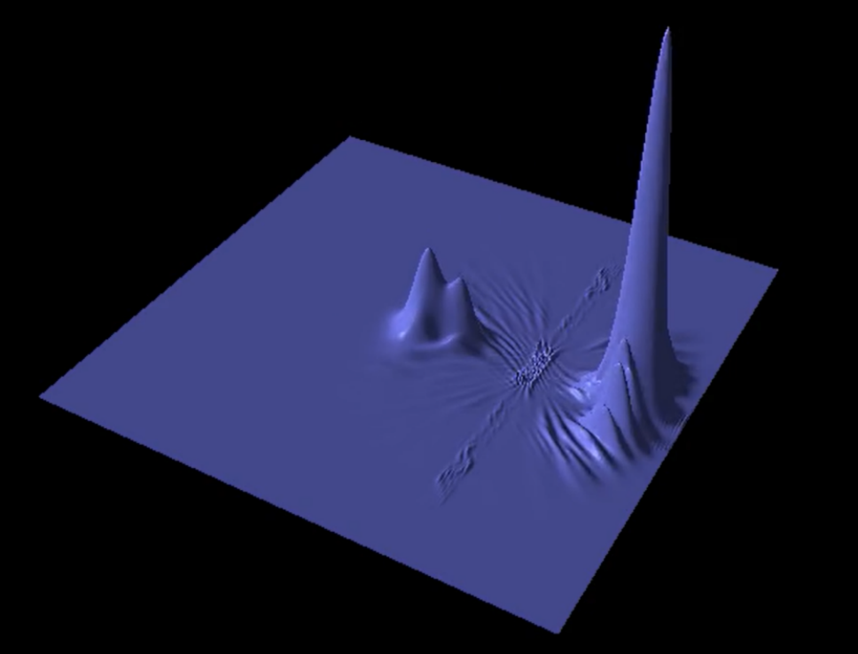
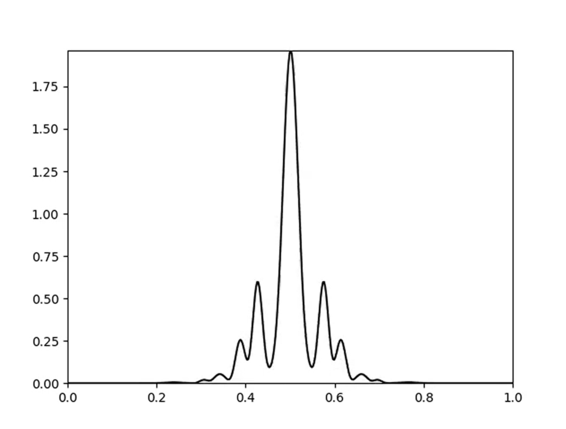

# Numerical Solver for the Schrödinger Equation

C++ and Python implementation of a Crank–Nicolson and Gauss–Seidel numerical solver for the one- and two-dimensional time-dependent Schrödinger equation.

Developed over a two-week period during a high-school internship in Prof. Dr. Roser Valentí's research group at Goethe University Frankfurt (June 2023), exploring scenarios such as double-slit interference and Anderson localization. A short write-up from 2023 is included in `Numerical solution of the Schrödinger equation.pdf`.

> **Status:** Archived project — cleaned up for reference.

  
    
  
   
  <em><strong>Left:</strong> Wavepacket snapshot after traversing the double slit. <strong>Right:</strong> Intensity slice along a wall behind the double slit.</em>

## Features

- C++ numerical solver implementing Crank–Nicolson and Gauss–Seidel methods for the 1D/2D Schrödinger equation
- Python scripts for visualizing wavepacket dynamics and generating animations
- Helper shell scripts (`run.sh`, `make-vid.sh`) to streamline execution and video encoding

## Prerequisites

Originally written without strict pinned version numbers.

- **C++:** C++14 or C++17 compatible compiler (e.g., `g++` or `clang`) with the **Eigen** header library
- **Python:** 3.8+ with `matplotlib` and `vispy`
- **FFmpeg:** Required for rendering `.mp4` animations from frames

## Getting Started

1. Inspect and run the simulation workflow in `code/` using `run.sh`, or compile the C++ solver directly against `Eigen` and run the Python visualization scripts.
2. Render an `.mp4` animation from the output frames using `make-vid.sh` (requires `ffmpeg`).

## License

Licensed under the MIT License.
